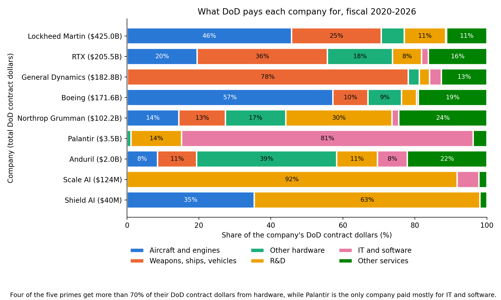
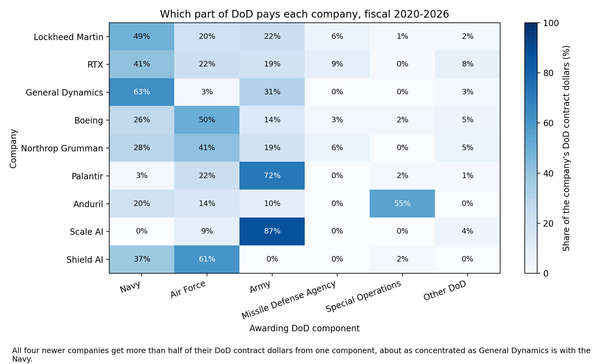

# Who Wins What: Profiling Defense Contractors in DoD Contract Data

INFO 4617 Web Data Science final project, Brody Kretz.

## Question

Across Department of Defense contract awards from fiscal 2020 through fiscal 2026, how do the biggest defense contractors differ in what they get paid for, and how dependent is each one on a single category of work or a single branch of the military?

## Companies

Lockheed Martin, RTX, Boeing, General Dynamics, Northrop Grumman, Palantir, Anduril, Shield AI, and Scale AI.

## Files

- `01_collect.ipynb` pulls award records from the USAspending API.
- `02_clean.ipynb` turns the raw records into a tidy dataset.
- `03_collect_totals.ipynb` pulls yearly DoD dollars by category and branch.
- `04_analyze.ipynb` computes the results and draws the figures.
- `data_dictionary.md` explains every field in the cleaned data.
- `data/sample_awards.csv` is a sample of the cleaned data: the ten largest awards for each company.
- `data/category_totals.csv` is the full set of yearly totals.
- `figures/` holds the saved figures.

## Data

**Source.** The [USAspending API](https://api.usaspending.gov/), the federal government's public record of spending under the DATA Act, using `POST /api/v2/search/spending_by_award/`. Requests send a User-Agent with my school email and pause one second between calls, and each response is saved to disk so nothing is pulled twice.

**Collected.** November 8, 2026.

**Scope.** Department of Defense contract awards (types A through D) active from fiscal 2020 through fiscal 2026, meaning October 1, 2019 through September 30, 2026. Each company is searched by its legal names, one fiscal year at a time.

**Records.** 18,145 rows came back from the API. Removing awards returned in more than one fiscal year leaves **5,070 awards** in the cleaned dataset.

**Limits.**
- The API stops at 10,000 records per search and the largest companies have far more. It lists 453,055 company-year award records for these nine companies, so I kept each company's 500 largest awards by dollars per fiscal year. Palantir, Anduril, Shield AI, and Scale AI were under that limit and are complete. The five primes are not, and their smallest awards are missing.
- `award_amount` is an award's lifetime total, so it can't be split by year. 2,381 awards started before fiscal 2020 and are flagged with `started_before_fy2020`.
- DoD contract data is published on about a 90-day delay, so the end of fiscal 2026 is incomplete.
- Company matches come from name searches. Subsidiaries and joint ventures are included when the API links them to a searched name, and the 28 rows for awards shared between two companies are flagged.
- The proposal's defense.gov announcement scrape is deferred. It isn't part of this dataset.

**Left out of the repo.** The full raw responses (`data/raw/`, about 28 MB) and the full cleaned file (`data/awards_clean.csv`) are not committed, because of their size and because this stage only needs a small sample. Terms of service and personal information aren't the reason: the data is public by law and covers a fixed list of large companies. Running `01_collect.ipynb` and then `02_clean.ipynb` rebuilds both.

**Yearly totals.** Collected November 10, 2026, from the `spending_by_category` endpoints: 12,264 rows of net dollars obligated per company, fiscal year, and category. These have no 500-award limit, and the file is small enough to be in the repo in full.

## Methods

The analysis in `04_analyze.ipynb` uses the yearly totals rather than the award records. An award's `award_amount` is a lifetime total, and 56% to 76% of each prime's award dollars came from awards that started before fiscal 2020, so summing awards would credit this window with money from earlier years. The yearly totals count only dollars obligated in each fiscal year, about $1.09 trillion across the nine companies.

- **Categories.** Hundreds of Product and Service Codes are grouped by hand into six buckets by their leading characters: aircraft and engines, weapons/ships/vehicles, other hardware, R&D, IT and software, and other services.
- **Branches.** Dollars are grouped by the DoD component that made the award: Navy, Air Force, Army, Missile Defense Agency, Special Operations Command, and everything else as Other DoD.
- **Shares.** Each company's dollars in a bucket or branch, divided by its total for fiscal 2020 through 2026.
- **Concentration score.** The share of a company's dollars in its single biggest bucket or branch.

## Preliminary findings

*Four of the five primes get more than 70% of their DoD contract dollars from hardware, while Palantir is the only company paid mostly for IT and software.*

*All four newer companies get more than half of their DoD contract dollars from one component, about as concentrated as General Dynamics is with the Navy.*

- **The primes are mostly hardware, as expected.** Lockheed Martin, RTX, General Dynamics, and Boeing each get 74% to 81% of their dollars from the three hardware buckets. Northrop Grumman is the exception at 44%, with 30% in R&D.
- **The newer companies don't share one profile.** Palantir is 81% IT and software. Scale AI is 92% R&D and Shield AI is 63% R&D. Anduril looks more like a hardware company, with 58% in hardware buckets and only 8% in IT and software.
- **The primes still hold more IT and software dollars.** The five primes received $13.9 billion in that bucket against $3.0 billion for the newer companies, which is the surprise the proposal named. It's a tiny part of their business, though, at 0.3% to 3.3%, and Palantir alone ($2.8 billion) received more than Northrop Grumman, Lockheed Martin, or Boeing.
- **The newer companies depend heavily on one customer.** Scale AI gets 87% of its dollars from the Army, Palantir 72% from the Army, Shield AI 61% from the Air Force, and Anduril 55% from Special Operations Command. Among the primes, only General Dynamics (63% Navy) is in that range.
- **The newer companies are growing fast from a small base.** Palantir went from $0.14 billion in fiscal 2020 to $1.68 billion in fiscal 2026, and Anduril from $0.03 billion to $0.66 billion. Lockheed Martin alone received $425 billion over the period, against $5.6 billion for all four newer companies combined.

**Cautions.**
- The awarding branch isn't always the branch that uses the product. The Navy runs the F-35 contracts for all services, including Air Force aircraft, so Lockheed Martin's 49% Navy share overstates its dependence on the Navy.
- PSC codes are coarse. Anduril's largest code is "hardware, commercial", which says little about what it sold.
- Shield AI ($40 million) and Scale AI ($120 million) have few awards, so one contract moves their shares a lot.
- Fiscal 2026 is incomplete, so the last year's dollars will rise as data is published.
- The competed versus sole source comparison from the proposal isn't done yet.
